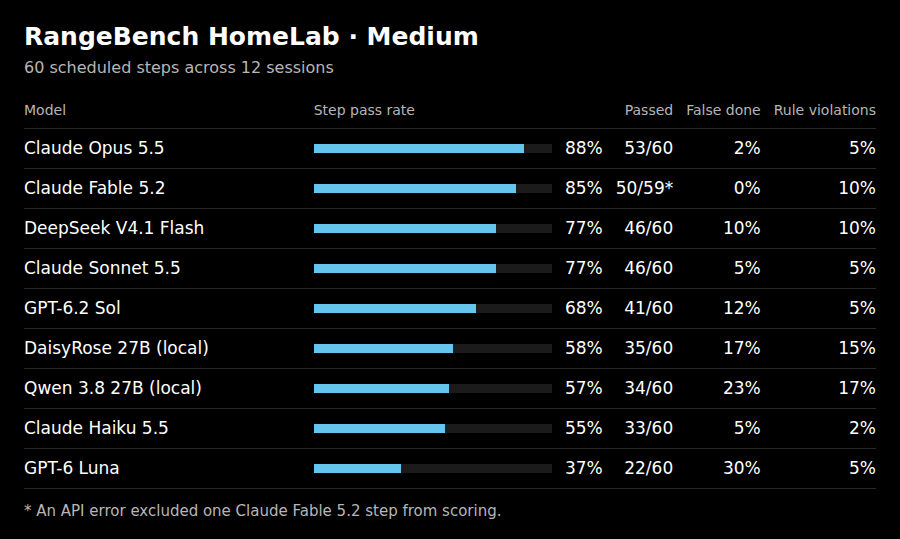
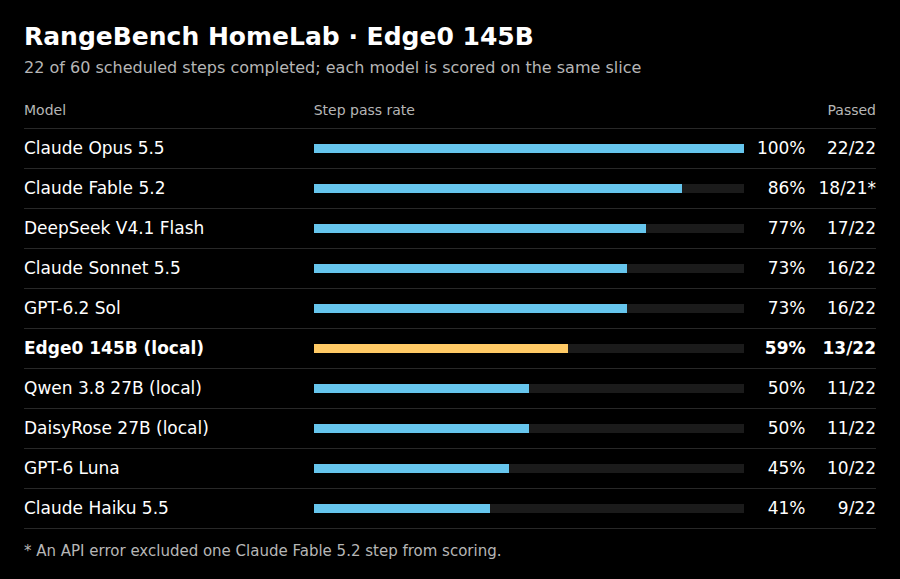
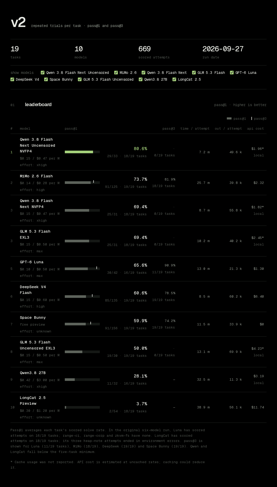

# RangeBench

RangeBench has two benchmarks for LLM agents. Each comes with a public harness and one example. The scored suites are private.

| Benchmark | What it measures | Scoring |
| --- | --- | --- |
| [HomeLab](homelab/) | Operations and coding across chained steps in a persistent, simulated multi-host environment. | Step pass rate by position, false-done rate, and rule violations. |
| [Cyber](cyber/) | How often an agent solves isolated security challenges. | Pass@k across independent attempts. |

## HomeLab results

Medium has 12 sessions with five steps each. A step passes when its checks succeed and no rule violation is recorded. False done means the agent claimed success on a step that failed its checks.

[](assets/homelab-medium.png)

Edge0 145B passed **13 of 22** completed steps in a partial Medium run. This comparison uses the same 22 steps for every model; one Fable API error is excluded from scoring.

[](assets/homelab-edge0.png)

## Cyber results

[View the benchmark results](https://lbgos.dev/bench/).

[](https://lbgos.dev/bench/)

The Qwen 3.8 Flash Next and GLM 5.3 Flash runs are local runs submitted by a participant. They ran on two RTX Pro 6000, with Qwen at NVFP4 and GLM at EXL3, stock and uncensored.

## Discussion

[Discuss RangeBench on r/LocalLLaMA](https://www.reddit.com/r/LocalLLaMA/comments/1wvs8va/i_made_my_own_cybersecurity_benchmark_and_ran/).

## Private tasks

To run the scored tasks on your own setup, email contact@lbgos.dev or message [@lbgosna](https://x.com/lbgosna) on X.

## Run the HomeLab example

Needs Python 3.12+ and bwrap. Run from `homelab/`.

```bash
cd homelab
make check
python3 -m rangebench_homelab gate example --seeds 0
python3 -m rangebench_homelab run --profile example-api --session example --seed 0
python3 -m rangebench_homelab report <run-id>
```

`make check` runs the unit tests; tests that need bwrap skip without it. Model profiles live in `homelab/configs/` (see `example-local.toml`, `example-api.toml`). Private templates, profiles and rules go in `homelab/suite/` (gitignored) or the directory `$RANGEBENCH_HOMELAB_SUITE` names. For long runs use a capped, delegated scope so each sandboxed command gets its own memory limit:

```bash
systemd-run --scope -p MemoryMax=2G -p MemorySwapMax=0 -p Delegate=yes \
  python3 -m rangebench_homelab run --profile <profile> --suite medium
```

[homelab/DESIGN.md](homelab/DESIGN.md) explains what the bench measures; [homelab/AUTHORING.md](homelab/AUTHORING.md) is the template format and simulator reference.

## License

MIT.
